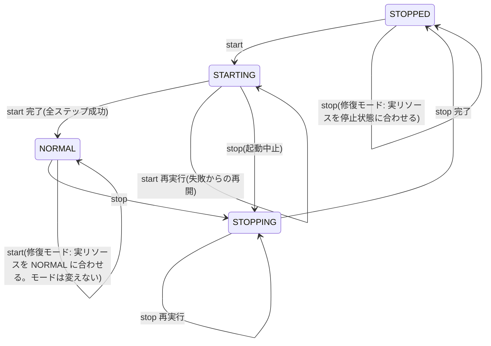

# OPERATIONS_DESIGN（T1.8 運用モード・一括起動/停止/状態確認の確定設計）

確定日: 2026-10-22（**設計上の確定**。実リソースでの検証は第5段階の検証ゲート §12）。前提: GCP 採用（DECISIONS I-011）、構成は `ARCHITECTURE.md`、契約の正本は jra-bot-web `docs/CONTRACTS.md`（0.3.0-draft）。Terraform 実装・apply・課金リソース作成は行っていない。

## 1. 運用モード
| モード | 意味 | 外部から見た挙動 |
|---|---|---|
| `NORMAL` | 通常運用 | dashboard 閲覧可（IAP）、ingest 受付、Scheduler 有効、bot は開催日の必要時間帯のみ（calendar-check が判断）、エージェント送信可 |
| `STARTING` | 起動処理中（または起動途中で失敗） | **エージェント送信禁止**、bot 起動禁止、dashboard/ingest は最終段まで受付停止 |
| `STOPPING` | 停止処理中（または停止途中で失敗） | **エージェント送信禁止**、bot 新規起動禁止・実行中は排出（DRAINING）、ingest は 503 + `X-Ops-Mode: STOPPING` |
| `STOPPED` | 全停止（データのみ保持） | dashboard/ingest は外部受付なし（ingress 内部限定）、Scheduler 停止、DB 停止、エージェントはビーコンで STOPPED を確認し待機 |
- **安全側の原則**: `NORMAL` 以外はすべて「新しい処理を始めない・データを送らない」。途中失敗は `STARTING` / `STOPPING` のまま残り（`operation.status=FAILED`）、**自動で NORMAL に戻すことは無い**。
- 「希望（desired）」と「実際（actual）」を分ける: `desired` は操作者の意図（`NORMAL` or `STOPPED`）、`mode` は現在のフェーズ、`actual` は各リソースを都度計測した値。

### 1.1 状態遷移（許可されるもの）

- **拒否する遷移**: `STOPPING → STARTING`（停止を完了させてから start。強制する場合は `force=true` と理由が必須で、記録に残す）、ロック保持中の別操作、`schema_version` 不一致、`seq` の巻き戻し。
- `status` は遷移を起こさない（読み取りのみ）。

## 2. 状態の正本（GCS）
### 2.1 置き場と権限
| オブジェクト | バケット | 公開 | 書込 | 読取 |
|---|---|---|---|---|
| `state/ops-state.json`（正本） | `<prj>-ops-state`（東京、非公開、**オブジェクトのバージョニング有効**、均一アクセス） | 非公開 | `sa-gha-ops` のみ | dashboard / ingest / bot / calendar-check / ml-train の各ランタイム SA（読取のみ）、`sa-gha-deploy`/`sa-gha-tf`（読取: ガード用） |
| `history/YYYY/MM/<utc>-<op>-<run_id>.json`（変更履歴、追記のみ） | 同上 | 非公開 | `sa-gha-ops` | 管理者 |
| `agent/heartbeat-<tenant>.json`（エージェント最終接続の写し） | 同上 | 非公開 | `sa-ingest`（このプレフィックスのみ） | `sa-gha-ops` |
| `beacon/mode.json`（エージェント向けビーコン） | `<prj>-mode-beacon`（**このオブジェクト専用バケット**、東京） | **公開読取（allUsers objectViewer）**。中身は秘密を含まず Ed25519 署名付き | `sa-gha-ops` のみ | 誰でも（エージェント） |
- ビーコン専用バケットにする理由: 正本バケットを公開しないため。ビーコンには `mode/seq/時刻/署名` 以外を書かない。
- 状態はすべて **DB 非依存**（DB 停止中も読める）。DB 内のモードは表示用コピー（web D-005）。
- 保持: `history/` はライフサイクル 400 日、`ops-state.json` の旧バージョンは 90 日。

### 2.2 `ops-state.json`（schema_version 1）
```json
{
  "schema_version": 1,
  "seq": 42,
  "mode": "STOPPING",
  "desired": { "mode": "STOPPED", "set_by": "github:puttun777", "set_at": "2026-11-01T10:00:00Z", "reason": "月末停止" },
  "operation": {
    "id": "01J…", "type": "stop", "status": "RUNNING|SUCCEEDED|FAILED", "force": false,
    "run_url": "https://github.com/puttun777/jra-bot-infra/actions/runs/…", "actor": "puttun777",
    "started_at": "…", "finished_at": null, "current_step": "S5_jobs_drain",
    "steps": [ { "name": "S1_state_stopping", "status": "DONE", "at": "…", "detail": "" } ],
    "error": null
  },
  "lease": { "holder": "<run_id>", "expires_at": "2026-11-01T11:00:00Z" },
  "beacon": { "seq": 42, "mode": "STOPPING", "updated_at": "…" },
  "last_actual": { "captured_at": "…", "db": "RUNNABLE", "dashboard_ingress": "internal", "ingest_ingress": "internal", "scheduler": {"calendar-check":"PAUSED"}, "running_executions": 0 },
  "release": { "manifest_version": "…", "flyway_version": "…" }
}
```
- `seq` は書込ごとに +1（単調増加）。ビーコンの `seq` は `ops-state.seq` と同期。

### 2.3 排他・更新規則
1. **GitHub Actions の `concurrency`**: `group: ops-prod`、`cancel-in-progress: false` を start / stop / deploy / terraform-apply / ml-train 手動起動に共通で設定（同時に 1 つ）。status は読み取りのみなので別グループ。
2. **GCS の条件付き書込（CAS）**: 読み込んだ `generation` を `ifGenerationMatch` に指定して書く。競合（412）なら再読込して遷移規則を再判定。これで Actions 以外（手動の gcloud）との競合も防ぐ。
3. **リース**: 操作開始時に `lease.holder=<run_id>`、期限 90 分。期限内に別の run が来たら拒否。期限切れのリースは、同じ種類の操作の再実行のみが奪取できる（記録に残す）。
4. **更新失敗時**: 状態書込に失敗したら**その時点で処理を中断**（リソース操作を先に進めない）。リソース操作が成功して状態書込が失敗した場合は、次の実行が `actual` を計測して収束させる（各ステップは冪等）。
5. 書込のたびに `history/` へ同内容を追記（変更履歴）。

### 2.4 アプリ側の読み方（web への要求、CONTRACTS へ反映）
- `ModeProvider` は GCS から `ops-state.json` を読み、15 秒キャッシュ。**読めない場合は `UNKNOWN` = NORMAL 扱いしない**。
- bot / calendar-check: 起動直後、DB 接続より先にモード確認。**確定した非 NORMAL（STARTING/STOPPING/STOPPED）なら終了 exit 0**（理由 `MODE_<mode>` を記録。再試行しない）。**UNKNOWN（読めない・不正）は exit 75**（開催日に GCS 障害で何もしなかったことに気付けるようにするため。web CONTRACTS §9.1、D-048。T5.0 で同期: I-H1）。status と通知では 75 を異常として扱う。
- ingest: `NORMAL` 以外は DB に触れず `503 + X-Ops-Mode: <mode>`（UNKNOWN は `X-Ops-Mode` なし）。
- dashboard: `NORMAL` 以外は上部に固定バナー。STOPPED では ingress が内部限定のため到達不能（§4.2）。

## 3. モード署名付きビーコン
- 形式（web CONTRACTS §7.2 と同一。**T5.0 で同期: I-H4**）: `{ "schema_version", "kid", "mode", "seq", "updatedAt", "validUntil"?, "sig" }`。**`phase` は廃止**（`mode` が現在のフェーズ。意図は ops-state.json の `desired`）。`kid` は署名鍵の識別子（エージェントは最大 2 本の公開鍵〔`MODE_BEACON_PUBKEYS`〕から `kid` で選ぶ）。`sig = Ed25519(秘密鍵, canonical_json(他フィールド))`。
- **秘密鍵の保管: Secret Manager**（`beacon-signing-key`）。`sa-gha-ops` のみ `secretAccessor`。GitHub のシークレットには置かない（長期の秘密を GitHub に置かない方針。web CONTRACTS の「CI シークレット」記述は修正依頼: §11）。
- 公開鍵はエージェントに埋め込み（web 側の配布物）。鍵ローテーション時は新旧 2 鍵を受理する期間を設ける（web 側）。
- 書込: `Cache-Control: no-store`、`Content-Type: application/json`。
- 更新タイミング: start は `STARTING`（最初）→ `NORMAL`（最後）、stop は `STOPPING`（最初）→ `STOPPED`（最後）。

## 4. 各リソースの「起動/停止」の操作内容
### 4.1 一覧
| リソース | NORMAL 時 | STOPPED 時 | 操作コマンド（方針） | 停止中の課金 |
|---|---|---|---|---|
| Cloud SQL（Enterprise, db-g1-small, プライベート IP のみ） | `activation-policy=ALWAYS`（RUNNABLE） | `activation-policy=NEVER`（STOPPED） | `gcloud sql instances patch --activation-policy=…` + 状態ポーリング | ストレージ・バックアップ（公開 IP を持たないので IP 課金なし※要確認） |
| Cloud Run `dashboard`（直接 IAP、min=0） | `ingress=all`、IAP 有効、許可リストは Terraform | `ingress=internal` | `gcloud run services update --ingress=…` | なし（スケールゼロ） |
| Cloud Run `ingest`（min=0、アプリ認証） | `ingress=all` | `ingress=internal` | 同上 | なし |
| Cloud Run Jobs `bot` / `calendar-check` / `reconcile` / `retention` / `db-migration` / `ml-train` / `export-dataset` / `backtest` | 定義のみ（実行は Scheduler/手動） | 実行中のものを排出→キャンセル | `gcloud run jobs executions list/cancel` | なし |
| Cloud Scheduler（`calendar-check`、`reconcile`、`retention`、`ml-train`[初期 paused]） | `ENABLED`（ml-train は設定次第） | `PAUSED` | `gcloud scheduler jobs pause/resume` | ジョブ数課金（停止中も） |
| ビーコン / 状態 | `NORMAL` | `STOPPED` | GCS 書込（CAS） | 極小 |
- **bot を start/stop が直接起動することは無い**（開催判定は calendar-check。非開催日に NORMAL へ戻しても bot は起動しない: 要件）。
- `STOPPED` で dashboard は**表示できない**（ingress 内部限定）。停止中の状態確認は `status` ワークフロー（GitHub の Job Summary）で行う。※ LB を置けば停止ページを出せるが固定費が増えるため採用しない。

### 4.2 dashboard 停止の方式（比較）
| 方式 | 評価 |
|---|---|
| **`ingress=internal`（採用）** | 外部からの全リクエストを拒否（IAP を通る前に拒否）。設定 1 つで冪等、認証を緩める操作を含まない |
| IAP の許可リストを空にする | 誤って「IAP 無効化」と組み合わせると公開になる危険。許可リストは Terraform 管理のまま触らない |
| サービス削除 | 不可逆に近く、再作成で設定がぶれる |
→ **STOPPED でも IAP 設定・IAM は一切変更しない**（認証が緩む経路を作らない）。

## 5. start ワークフロー（`ops-start.yml`, workflow_dispatch）
入力: `reason`（必須）、`apply_pending_migrations`（既定 false）、`force`（既定 false）、`dry_run`（既定 false）。
| # | ステップ | 内容 | 冪等/再実行 | 失敗時 |
|---|---|---|---|---|
| S0 | 認証・事前検査 | WIF で `sa-gha-ops`。`ops-state.json` 読込、遷移規則チェック（STOPPED / STARTING / NORMAL[修復] のみ可）、リース取得（CAS） | 何度でも可 | 拒否して終了（状態変更なし） |
| S1 | `mode=STARTING`、`desired=NORMAL` | CAS 書込 + 履歴 | 同値なら書込のみ | 中断 |
| S2 | ビーコン `STARTING` | 署名・書込（エージェントは待機のまま） | 同上 | 中断（S1 のまま=安全） |
| S3 | DB 起動 | `activation-policy=ALWAYS`、`RUNNABLE` まで待機（上限 20 分） | 既に RUNNABLE ならスキップ | `STARTING(FAILED)` で終了。再実行で続行 |
| S4 | DB 正常性 | `db-migration` Job を `--mode=validate` で実行（接続・スキーマ検証）。**終了コード: 0=適用済みが正しく未適用なし／10=正しいが未適用あり／1=不一致・失敗版あり／75=DB 不達**（web CONTRACTS §4.2。I-H2） | 読み取りのみ | 同上 |
| S5 | マイグレーション確認 | **S4 の終了コードが 10（未適用あり）のとき**、`apply_pending_migrations=true` のときのみ `migrate` を実行。false なら**失敗として停止**（通常の適用は deploy ワークフローの責務） | Flyway が冪等 | 同上 |
| S6 | ingest 復帰 | `ingress=all`（IAP なし・アプリ認証のみのサービス。モードがまだ STARTING なので受付は 503） | 同上 | 同上 |
| S7 | dashboard 復帰 | **事前に IAP 有効・許可リスト非空を検証**してから `ingress=all` | 同上 | IAP 検証失敗なら ingress を開けずに失敗 |
| S8 | ヘルスチェック | ingest `/internal/ready`（`sa-gha-ops` の ID トークンをアプリが検証）、dashboard `/internal/ready`（IAP をプログラムで通過: `sa-gha-ops` に dashboard の `iap.httpsResourceAccessor`） | 読み取り | 同上 |
| S9 | Scheduler 再開 | `calendar-check`/`reconcile`/`retention` を resume（`ml-train` は設定値に従う） | resume は冪等 | 同上（**NORMAL にしないので bot は起動しない**） |
| S10 | `mode=NORMAL` | CAS 書込 + 履歴 | — | 同上 |
| S11 | ビーコン `NORMAL` | 署名・書込（ここで初めてエージェントが送信再開） | — | `NORMAL` だがビーコン未更新 → エージェントは待機のまま（安全）。再実行で更新 |
| S12 | 実状態確認・解放 | status と同じ計測、Job Summary 出力、リース解放 | — | 不一致は警告として残す |
- **順序の最適化理由**: ①モードを先に STARTING にして、DB が上がった瞬間に古い Scheduler や手動実行が bot を始めないようにする。②ingest は dashboard より先に開ける（モードが STARTING の間は 503 を返すため安全）。③Scheduler 再開は NORMAL の直前（再開しても calendar-check はモード確認で何もしない）。④ビーコンは最後（エージェントは ingest が確実に受付可能になってから再開）。

## 6. stop ワークフロー（`ops-stop.yml`, workflow_dispatch）
入力: `reason`（必須）、`drain_timeout_min`（既定 15）、`take_backup`（既定 false）、`force`、`dry_run`。
| # | ステップ | 内容 | 冪等/再実行 | 失敗時（安全側） |
|---|---|---|---|---|
| S0 | 認証・事前検査・リース | 遷移規則（NORMAL / STARTING / STOPPING / STOPPED[修復]） | — | 拒否 |
| S1 | `mode=STOPPING`、`desired=STOPPED` | **最初に**状態を変える（全アプリが新規処理を止める） | 同値なら書込のみ | 書込失敗なら中断（何も変えていない） |
| S2 | ビーコン `STOPPING` | エージェントは取得・送信を停止 | — | 中断（S1 済み=アプリは既に停止方向） |
| S3 | Scheduler 停止 | 全ジョブ pause（新しい calendar-check/reconcile を起こさない） | 冪等 | `STOPPING(FAILED)` で終了。再実行で続行 |
| S4 | bot 新規起動の禁止確認 | calendar-check は S1 によりモード確認で起動しない。念のため実行中の calendar-check も確認 | 読み取り | — |
| S5 | 実行中 Job の排出 | 実行中の `bot` 等は次サイクルで STOPPING を検知して DRAINING→checkpoint→終了（RACE_CALENDAR_DESIGN §6.3）。`drain_timeout_min` まで待機 | 再実行可 | タイムアウト後 S6 へ |
| S6 | 残存 Job のキャンセル | `executions cancel`（SIGTERM。アプリは checkpoint 保存。猶予時間は要検証） | 冪等 | 失敗は警告として継続可否を判定（DB 停止前に必ず 0 件を確認、0 件にならなければ失敗で停止＝DB は止めない） |
| S7 | ingest / dashboard 受付停止 | `ingress=internal`（IAP・IAM は変更しない） | 冪等 | 失敗で停止 |
| S8 | DB 接続終了の確認 | 実行中 Job 0 件、両サービスへの外部到達不可を確認後、一定時間（例 60 秒）待機。可能なら Cloud SQL の接続数メトリクスを参照 | 読み取り | 未確認なら警告のうえ S9 は実施可（InnoDB は正常停止。アプリのプール接続は切断されエラーになるだけ） |
| S9 | （任意）バックアップ | `take_backup=true` ならオンデマンドバックアップ | — | 失敗なら DB を止めずに失敗 |
| S10 | DB 停止 | `activation-policy=NEVER`、`STOPPED` まで待機 | 既に停止ならスキップ | `STOPPING(FAILED)`。再実行 |
| S11 | `mode=STOPPED` | CAS 書込 + 履歴 | — | 再実行 |
| S12 | ビーコン `STOPPED` | — | — | `STOPPING` のまま（エージェントは送信しないので安全） |
| S13 | 実状態確認・解放 | status と同じ計測、Job Summary、リース解放 | — | 不一致は警告 |
- **途中失敗はすべて `STOPPING` のまま**＝新規処理はすべて止まっている。再実行は完了済みステップを計測でスキップ。**失敗を理由に NORMAL へ戻さない**。

## 7. status ワークフロー（`ops-status.yml`, workflow_dispatch + 毎日 1 回の定期実行）
読み取り専用（リース不要）。結果を Job Summary（Markdown 表）と `status.json`（Artifact）に出力。
| 項目 | 取得元 | 判定 |
|---|---|---|
| desired / mode / 最後の操作（種類・結果・時刻・run URL）・部分失敗のステップ | `ops-state.json` | `operation.status=FAILED` は ❌ |
| DB 状態（RUNNABLE/STOPPED/MAINTENANCE 等）、activation policy、エディション、版 | Cloud SQL API | mode と不整合なら ❌（例: STOPPED なのに RUNNABLE ＝**意図しない起動・課金**） |
| dashboard: ingress、最新リビジョン Ready、IAP 有効、許可リスト件数 | Cloud Run / IAP API | STOPPED で ingress=all、NORMAL で IAP 無効は ❌ |
| ingest: ingress、Ready | Cloud Run | 同上 |
| bot 実行状況: 実行中/直近の execution（開始・終了・結果） | Cloud Run Jobs API | STOPPED で実行中は ❌ |
| Scheduler: 各ジョブ ENABLED/PAUSED、直近実行 | Cloud Scheduler | STOPPED で ENABLED は ❌ |
| ビーコン: 公開 URL から取得し署名検証、`seq` と `ops-state.seq` の一致 | HTTPS + 公開鍵 | 不一致・署名不正は ❌ |
| Windows エージェント最終接続 | `agent/heartbeat-<tenant>.json`（ingest が 5 分ごと/変化時に書く写し）。DB 稼働中は DB の値も | NORMAL で開催日ウィンドウ中に 15 分超なら ⚠️ |
| 費用の兆候 | 上記の不整合から推定（例: DB が想定外に RUNNABLE） | ❌ |
表示例（Job Summary）:
```
| 項目 | 期待 | 実際 | 判定 |
| mode | STOPPED | STOPPED | ✅ |
| Cloud SQL | STOPPED | RUNNABLE | ❌ 意図しない起動（課金中） |
```
- 定期 status（毎日 09:00 JST 付近、GitHub Actions の schedule）で不整合を検知したら **Discord のエラー用 Webhook** に通知（Secret Manager の値を WIF で取得）。**自動修復はしない**（意図しない起動・課金を避けるため、修復は人が start/stop を実行）。

## 8. 停止中の意図しない再起動・状態変更を防ぐ仕組み（ignore_changes だけに依存しない）
### 8.1 影響マトリクス（どの変更がどのモードに影響するか）
| 属性/操作 | 書く主体 | 影響するモード | ガード |
|---|---|---|---|
| Cloud SQL `activation_policy` | **ops のみ** | NORMAL/STOPPED（課金） | Terraform: `ignore_changes`、作成時の初期値は **`ALWAYS`**（DB・ユーザーの作成が起動中でないと失敗するため。T5.2 の実装で訂正）。**初回 apply の直後は DB が起動して課金中なので、直ちに ops-stop を実行して STOPPED に揃える**（OPERATIONS.md §1）。**apply 前ガード**（§8.2）で変更を検出したら失敗 |
| Cloud SQL のマシン種別・フラグ・メンテナンス設定 | Terraform | 変更時に**再起動**を伴うことがある | apply 前ガード: mode=NORMAL のときのみ許可、STOPPED 中の apply は「停止中の DB を起動しうる変更」を拒否 |
| Cloud Run service `ingress` | **ops のみ** | 受付可否 | Terraform: `ignore_changes`、作成時の初期値は `internal`。deploy は ingress を指定しない（`gcloud run deploy` は既存 ingress を保持）→ deploy 後に status で検証 |
| Cloud Run service の IAP 有効・許可リスト（IAM） | Terraform | 認証 | ops は**触らない**。status で常時検証 |
| Cloud Run のイメージ（revision） | deploy | なし（ingress を変えない） | STOPPED 中の deploy は既定で拒否。`allow_when_stopped=true` のときイメージ参照のみ更新し、migration は実行しない |
| Cloud Run Jobs 定義 | Terraform / deploy | なし（実行しない） | deploy/apply は**実行しない**（`--execute-now` 等を使わない） |
| Scheduler `paused` | **ops のみ** | bot 起動経路 | Terraform: `ignore_changes`、作成時は `paused=true` |
| ビーコン・状態オブジェクトの**中身** | **ops のみ** | エージェント・全アプリ | Terraform はバケットのみ管理（オブジェクトを管理しない） |
| migration 実行 | deploy（NORMAL 時のみ）/ start（明示時のみ） | DB スキーマ | DB 停止中は実行不可。deploy は mode=NORMAL を要求 |
| 予算アラート・監視 | Terraform | なし | — |
### 8.2 apply 前ガード（`terraform-plan`/`terraform-apply` ワークフロー）
1. `ops-state.json` を読み、`mode` と `operation.status` を確認。`STARTING/STOPPING` 中、または他操作のリース中は apply 不可（concurrency でも直列化）。
2. `terraform show -json plan` を検査するスクリプト（jq）で、**モード制御属性（`activation_policy`、`ingress`、`paused`、ビーコン/状態オブジェクト）への差分**、および **Cloud SQL・Cloud Run の再作成（replace）**を検出したら失敗。意図的な変更は `allow_mode_attr_change=true` + 理由で明示的に許可し、記録。
3. mode=STOPPED のとき、Cloud SQL の更新（再起動を伴いうる変更）を含む plan は拒否（停止中の DB を起動させない）。
4. apply 後に status を自動実行して不一致がないか確認。
5. apply は `prod` 環境（GitHub Environment）で**手動承認**必須。

### 8.3 自動復旧による課金の防止
- Scheduler・監視・アプリのいずれも**DB を起動しない**（DB を起動できるのは ops の start のみ。ランタイム SA に Cloud SQL の管理権限を与えない）。
- Cloud Run Jobs の自動リトライは `max-retries=0`（bot/calendar-check）。DB 不達時は exit 75 で終わり、Scheduler は次の定時まで何もしない。
- 定期 status は通知のみで修復しない。
- **残る制約**: Cloud SQL が**停止中にメンテナンス等で自ら起動するか**は公式に確認できていない（§12 G-OPS-3）。起動していた場合は定期 status が検知して通知する（最長 24 時間の課金が発生しうる）。

## 9. 監視（停止・復帰の失敗を見逃さない）
| 対象 | 方法 | 通知 |
|---|---|---|
| start/stop の失敗 | ワークフロー失敗時に Discord エラー Webhook へ（run URL・失敗ステップ・再実行方法） | Discord |
| STARTING/STOPPING の長期化（> 60 分） | 定期 status | Discord |
| 状態不一致（意図しない起動、ingress 開放、Scheduler 有効化） | 定期 status（毎日）+ 操作直後の status | Discord |
| bot/エージェント | web 側（ハートビート欠落、取得失敗、ingest_gap） | Discord |
| 費用 | 予算アラート（請求アカウント側の設定が必要＝**ユーザー作業**。Terraform で作るには請求アカウントの権限が要るため、権限の付与はユーザー判断） | メール |
- Cloud Monitoring のアラートポリシーは 2027-09-01 以降に課金開始（指標参照あたり $0.35/月）予定のため、初期は「アップタイム/ログ型を最小限」+ GitHub Actions の定期 status を主にする（CLOUD_COSTS §10）。

## 10. 手動復旧（Runbook 要約。詳細は第5段階で OPERATIONS.md）
| 症状 | 原因の例 | 手順 |
|---|---|---|
| `STARTING(FAILED)` | DB 起動タイムアウト、migration 保留、ヘルスチェック失敗 | status で失敗ステップ確認 → 原因解消 → **start を再実行**（完了済みはスキップ）。起動を諦める場合は stop |
| `STOPPING(FAILED)` | Job が終わらない、ingress 更新失敗、DB 停止失敗 | status → 原因解消 → **stop を再実行**。Job が残る場合は手動 cancel 後に再実行 |
| リースが残っている | ワークフローが強制終了 | 期限（90 分）後に同じ操作を再実行（自動奪取）。急ぐ場合は `force=true` + 理由 |
| 状態ファイル破損/不正 | 手動編集の誤り | GCS のオブジェクトバージョンから直前版を復元（`gsutil cp …#<generation>`）→ status |
| ビーコン署名不正 | 鍵の取違え | 鍵を確認し start/stop の該当ステップを再実行（ビーコンは状態から再生成） |
| STOPPED なのに DB が RUNNABLE | 不明な自動起動、手動操作 | 原因を記録 → **stop を再実行**（修復モード） |
| GitHub Actions が使えない | 障害 | 最終手段として、所有者が Cloud Console で同じ順序を手作業で実行（**状態ファイルも必ず更新**）。手順は OPERATIONS.md に記載 |

## 11. 認証・権限（運用まわり）
| 主体 | 用途 | 主な権限（最小） |
|---|---|---|
| `sa-gha-ops`（WIF: `jra-bot-infra` の `main` からの `ops-*.yml` のみ） | start/stop/status | Cloud SQL: インスタンスの get/update/backup（カスタムロール）、Cloud Run: service get/update（ingress）、jobs/executions get/list/cancel、`run.jobs.run`（db-migration の validate のみ）、Scheduler: get/list/pause/resume、GCS: `ops-state`/`mode-beacon` の objectAdmin、Secret: `beacon-signing-key`・`discord-error-webhook` の accessor、IAP: dashboard の `httpsResourceAccessor`（ヘルスチェック用） |
| `sa-gha-deploy`（WIF: `deploy.yml`） | イメージ更新、migration 実行（NORMAL のみ） | Cloud Run developer 相当（カスタム）、ランタイム SA の `iam.serviceAccountUser`、Artifact Registry reader、`ops-state` 読取 |
| `sa-gha-tf`（WIF: `terraform-*.yml`、Environment 承認） | Terraform | プロジェクトの構成管理に必要な権限（第5段階で最小化）。`ops-state` 読取 |
| ランタイム SA（dashboard / ingest / bot / calendar-check / reconcile / db-migration / ml-train） | アプリ実行 | `cloudsql.client`、各自の Secret のみ、`ops-state` 読取、その他は ARCHITECTURE §5 |
- WIF の条件: `assertion.repository == "puttun777/jra-bot-infra"`、`assertion.ref == "refs/heads/main"`、`assertion.workflow_ref` で対象ワークフローを限定。**長期の SA キーは作らない**。
- STOPPED 中も**認証設定（IAP・IAM・アプリの許可リスト）は変更しない**。

## 12. 検証ゲート（実リソースが必要。第5段階で実施、ユーザー承認後）
| ID | 検証内容 | 失敗時の代替 |
|---|---|---|
| G-OPS-1 | `ingress=internal` の Cloud Run（直接 IAP 有効）に外部から到達できないこと、`ingress=all` 復帰で IAP が維持されること | IAP + 許可リスト空化はしない。代替は「サービスの min/max 調整 + アプリの STOPPED 応答」 |
| G-OPS-2 | `activation-policy` の NEVER/ALWAYS 切替時間、停止中の課金項目（請求レポートで IP 課金がないこと） | 停止時間の見積りを更新 |
| G-OPS-3 | **停止中の Cloud SQL がメンテナンスで起動しないか**（メンテナンス枠をまたいで停止を維持し、定期 status で観測） | 起動する場合は「停止中に定期 stop（修復）」の頻度を上げる、またはメンテナンス枠・拒否期間の設定 |
| G-OPS-4 | Cloud Run Jobs の execution cancel 時のシグナルと猶予時間（**アプリは猶予 10 秒を前提**。bot-run は SIGTERM で checkpoint を保存し `INTERRUPTED`。NORMAL 中に cancel されたら exit 75。I-H7）、bot の checkpoint 保存 | 排出（DRAINING）待ちを長くする |
| G-OPS-5 | Cloud Run Jobs のタスク最大実行時間が bot-run の上限（14 時間）を満たすこと | 満たさない場合は bot-run を時間帯で分割し checkpoint から再開（RACE_CALENDAR の再開機能を使用） |
| G-OPS-6 | GCS の `ifGenerationMatch` による CAS、オブジェクトバージョニングでの復元 | — |
| G-OPS-7 | IAP のプログラムからの通過（`sa-gha-ops` の ID トークン）と、アプリ側の ID トークン検証 | ヘルスチェックを Cloud Run の Ready 状態のみに縮退 |
| G-OPS-8 | 組織なしプロジェクトでの直接 IAP（外部ユーザー用のカスタム OAuth クライアントは**手動作成が必要**）とテストユーザー運用 | ARCHITECTURE §6 |
| G-OPS-9 | Terraform の apply 前ガード（jq）の誤検知/検知漏れ | ガードを強化 |
